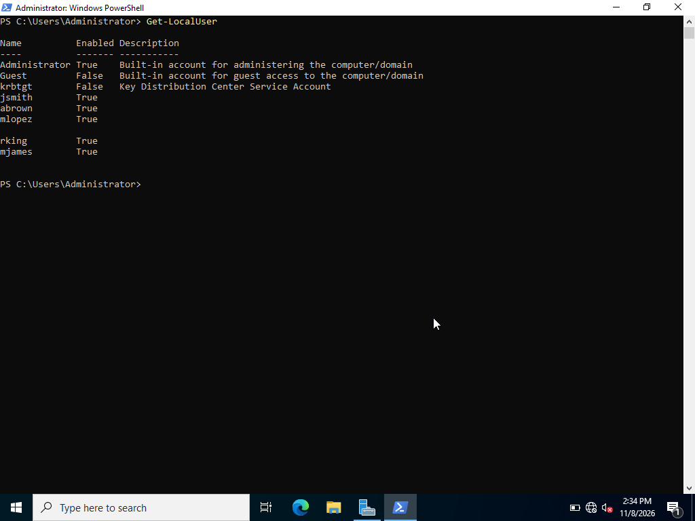

# AD / IAM Home Lab

A hands-on learning lab where I'm building Identity and Access Management skills with Active Directory on Windows Server.

**This is a simulated learning lab, not a production environment.** Everything here runs in a virtual machine on my own computer, with a fictional organization and made-up users.

## About me

I'm Moise Bertrand. I hold the CompTIA Security+ certification, and I'm building practical IAM skills through labs like this one and documenting them publicly.

- Blog: https://moise2cyber.com
- Related lab: [duo-iam-grc-homelab](https://github.com/movezatl/duo-iam-grc-homelab) (Cisco Duo authentication log investigation, simulated)

## The lab setup

| Item | Detail |
|---|---|
| Server | Windows Server, hostname **DC01** |
| Virtualization | VirtualBox on my Mac |
| Domain | **MOISE.LAB** |
| Organization | **Atlanta Medical**, a fictional healthcare organization |
| Tools | Active Directory, PowerShell |

## What I've built so far

- A Windows Server domain controller (DC01) running in VirtualBox
- The domain MOISE.LAB
- A simulated healthcare organization, Atlanta Medical, with **HR** and **IT** departments and staff created in the directory
- A set of test user accounts, which I checked with PowerShell (see below)

## What I've learned so far

My first PowerShell commands for reviewing accounts on the server:

- `Get-ComputerInfo` to see which machine and Windows version I'm on
- `Get-LocalUser` to list the accounts and whether each one is enabled
- `Select-Object` to show only the columns I need
- `Where-Object` to filter results, for example only enabled accounts

Full notes with examples: [docs/01-powershell-user-and-system-commands.md](docs/01-powershell-user-and-system-commands.md)

### Screenshot



*`Get-LocalUser` on DC01. The built-in Administrator is enabled, Guest and krbtgt are disabled, and the test users are enabled. One account name is covered.*

## Why it matters

Knowing exactly which accounts exist, which are enabled, and what access they have is the starting point of an access review. IAM and GRC work depends on being able to check that, then back it up with clear documentation.

## Repository layout

```
ad-iam-homelab/
├── README.md
├── docs/
│   └── 01-powershell-user-and-system-commands.md
└── screenshots/
    └── 01-get-localuser.png
```

## In progress and next up

- [ ] Add the Physicians, Nursing, Reception and Billing departments
- [ ] DNS testing and name resolution
- [ ] Join a Windows client to the domain and test authentication
- [ ] Security groups and least-privilege permissions
- [ ] Build an OU with at least 150 users and 9 more detailed, access-driven groups
- [ ] Automate that build with PowerShell scripts
- [ ] Learn `Get-ADUser` and `Get-ADGroup` for domain accounts
- [ ] Export results to CSV as audit evidence

I'll add screenshots, scripts and notes here as I complete each step.
